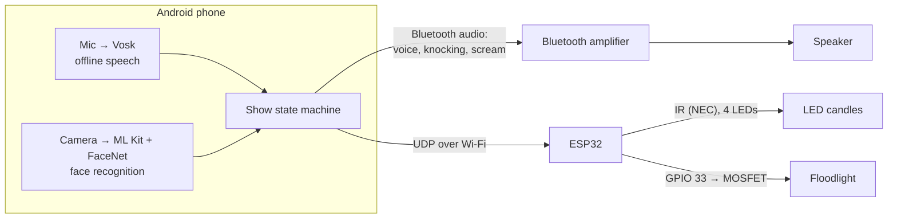

# Bloody Mary

[](https://github.com/ryosep2/bloody-mary/actions/workflows/build.yml)
[](LICENSE)


An interactive haunted-bathroom scare based on the Bloody Mary legend. A hidden
Android phone recognizes each guest, tempts them into saying **"bloody mary"**,
and escalates the scene every time they do: the candles die, something tries to
break in, and then the mirror lights up with a scream.

## How it works

| Moment | What happens |
|--------|--------------|
| Guest walks in     | The camera recognizes them and Mary greets them by name in a creepy ElevenLabs voice, promising riches, love or power if they say her name three times. Someone the camera doesn't recognize is told to "SPEAK YOUR NAME, CHILD", and Mary answers with the name they say |
| 1st "bloody mary"  | The flickering LED candles go out (IR remote code from four LEDs, sent 3× to reach every candle) |
| 2nd "bloody mary"  | Someone tries the door knob, knocks softly, then pounds on the door |
| 3rd "bloody mary"  | A floodlight lights up a mask behind a shadow box, Mary screams, then reveals the deal was a lie, by name |

All sound plays on a stereo speaker through a Bluetooth amplifier paired with
the phone. Each greeting and finale is picked at random from several versions.
After 1 minute without a new "bloody mary", whether mid-show or after the
scream, everything resets by itself for the next guest. The app also has a
**Reset** button.



**Highlights**
- Fully offline speech recognition ([Vosk](https://alphacephei.com/vosk/)),
  strict about hearing the whole phrase
- On-device face recognition (ML Kit + FaceNet). Photos and face data never leave the phone
- Personalized voice lines generated once with [ElevenLabs](https://elevenlabs.io)
  and cached, so they play instantly and offline during the show
- Low-latency triggers: one UDP packet per effect to an always-awake ESP32,
  with every sound preloaded
- Four IR LEDs driven by the same hardware PWM channel, spread out to cover every candle
- Wireless (OTA) firmware updates for the ESP32
- Every ESP32 effect can be tested without the phone, over serial or `curl`

## Hardware

| Part | Notes |
|------|-------|
| ESP32 DevKit V1 (DOIT) | Any ESP32 with Wi-Fi works |
| 4× IR LED (940 nm) + resistors | Spread out to cover the candles. A transistor driver gives much better range |
| Remote-controlled LED candles | NEC protocol. Other protocols work after capturing their codes |
| Bluetooth amplifier + passive speaker | Built with a Facmogu F900S (BT 5.0, 12 V), paired with the phone |
| 5 V USB spotlight | Must turn on when powered, with no button press |
| Logic-level N-MOSFET (AO3400, IRLZ44N) + 10 kΩ resistor | Or a 3.3 V-triggered relay module |
| Android phone | Built with a Galaxy S22, Android 10+ |

### Wiring

| Function    | ESP32 pin | Connection |
|-------------|-----------|------------|
| IR LED 1    | GPIO 27   | Anode, through the resistor or driver |
| IR LED 2–4  | GPIO 25, 26, 32 | Same, carrying an identical signal to GPIO 27. Point them in different directions or at the ceiling |
| Floodlight  | GPIO 33   | MOSFET gate, with 10 kΩ gate → GND. The MOSFET switches the spotlight's USB ground |

## Getting started

### 1. ESP32 firmware

You need [PlatformIO](https://platformio.org/), either the VS Code extension or
the CLI. The [IRremote](https://github.com/Arduino-IRremote/Arduino-IRremote)
library installs automatically.

```sh
cp include/secrets.example.h include/secrets.h   # 2.4 GHz Wi-Fi name/password + an OTA password
cp secrets.example.ini secrets.ini               # the same OTA password, for uploads
```

**First flash, over USB.** Set your serial port in [platformio.ini](platformio.ini):
`project_linux` uses `/dev/ttyUSB0`, `project_windows` uses `COM3`, and
`esp32doit-devkit-v1` auto-detects.

```sh
pio run -e project_linux -t upload
pio device monitor -e project_linux    # 115200 baud
```

```
=== Bloody Mary ===
[web] connected, IP 192.168.1.50
[web] http://bloodymary.local/status
[web] UDP commands on port 4210
```

Give the ESP32 a DHCP reservation in your router so its IP address stays the same.

**After that, update it over Wi-Fi.** No cable needed, as long as the ESP32 is
powered and on the network:

```sh
pio run -e project_ota -t upload
```

If `bloodymary.local` doesn't resolve on your computer, add
`--upload-port <esp32-ip>`.

### 2. Android app

1. Download [vosk-model-small-en-us-0.15](https://alphacephei.com/vosk/models)
   and unzip its contents (`am/`, `conf/`, `graph/`, `ivector/`) into
   `android/app/src/main/assets/model-en-us/`.
2. Download the face model
   [facenet_512.tflite](https://github.com/shubham0204/FaceRecognition_With_FaceNet_Android/raw/master/app/src/main/assets/facenet_512.tflite)
   (Apache-2.0) into `android/app/src/main/assets/`.
3. Add the sounds to `android/app/src/main/assets/`, as MP3 or WAV:
   - `breakin.mp3`: door knob, soft knocks, loud knocks
   - `scream.mp3`: the scream

   Audio files aren't included in this repo. Use your own or freely licensed
   ones (e.g. from [Freesound](https://freesound.org) or [Pixabay](https://pixabay.com/sound-effects/)).
4. Open the `android/` folder in Android Studio. Connect the phone with USB
   debugging on, and press **Run**.
5. Allow microphone and camera access. Enter the ESP32's address
   (`bloodymary.local` usually works, otherwise use its IP).

### 3. Pair the amplifier

Put the amplifier in Bluetooth mode and pair it from the phone's Bluetooth
settings. The app's status line should read `Amp: F900S connected`. While the
amp isn't connected, everything plays on the phone's own speaker instead.

### 4. Guests and voice

1. **Voice:** in **Settings**, enter your ElevenLabs API key and a voice ID.
   Pick or design a scary voice in ElevenLabs, then copy its ID. The model
   defaults to `eleven_v4`. The key is stored only on the phone.
2. **Guests**, either way, or both:
   - **Import photos:** put photos in a folder on the phone, named after each
     guest (`Sarah.jpg`, `Sarah_2.jpg`, `Mary_Jane.png`), and pick that folder.
     Several photos per person improve recognition. The app remembers the
     folder and checks it every time it opens: new, renamed or deleted photos
     and edits to `lines.json` update the guests by themselves.
   - **Add guest:** type a name, have them look at the camera, press Capture.
3. Each guest's lines are generated right away and saved. This needs internet
   then, but not during the show. Only the line's text, including the guest's
   name, is sent to ElevenLabs. **Guests → Generate voices** fills in anything
   missing; lines already generated aren't paid for again.

**Per-guest settings (optional).** Put a `lines.json` next to the photos, and
**Import photos** loads it too. Everything in it is optional:

```json
{
  "Sarah": {
    "say": "Sah-rah",
    "finales": ["Your last song, Sarah... and I'm keeping your fingers."]
  }
}
```

- `say`: how to spell the guest's name so it's pronounced right in the spoken lines.
- `finales` (and `greetings`, if you want them): the guest's own lines instead
  of the general ones. By default, a recognized guest hears the general
  greeting with their name in it.

Names must match the photo names. The file stays on the phone, never in the
app or this repo.

The general lines live in `VoiceLines` ([VoiceBank.kt](android/app/src/main/java/com/bloodymary/app/VoiceBank.kt)):
3 greetings and 3 finales, each with a named version and a version for
unrecognized guests. Add,
remove or edit versions freely; changed lines are regenerated automatically.
Each version is generated once per guest, so more versions use more ElevenLabs
credits (about 1,000 characters per guest with 3 + 3). Until a line is
generated, the phone's own voice says it, pitched down.

**Unrecognized guests:** after "SPEAK YOUR NAME, CHILD", the phone listens
for about 6 seconds and picks out the name ("it's Sarah", "Mike", "my name is
Jess"). A name on the guest list gets that guest's lines, which helps when the
camera misses someone in the dark. A new name gets a short filler line while
the greeting with that name is made on the spot (about 3 seconds; this needs
internet). If they say nothing, she carries on without a name.

**Camera placement:** the phone has to see guests' faces with some light on
them. For dim rooms the app uses a long exposure, brightens dark frames,
averages each face over a few seconds, and won't guess a name when two guests
look about equally likely. A dim light on the face still helps most. For the
best results, use **Add guest** to capture key guests (or yourself) in the
actual room lighting, in addition to their photos. The rear camera is the default; the **Rear camera / Front
camera** button switches between them. **Hide camera** turns off the on-screen
preview while recognition keeps running. The screen shows who it sees and the match score;
names are used above 0.5 (`MATCH_THRESHOLD` in `GuestStore.kt`).

The show resets itself after 1 minute idle. **Reset** does it by hand (and lets
the camera greet you again right away), and **Next stage** fires the next effect
for rehearsals. Long-press **Next stage** to rehearse the "SPEAK YOUR NAME,
CHILD" greeting without needing a stranger. The screen shows what the recognizer is hearing, which helps
when tuning.

## Testing the ESP32 without the phone

**Serial monitor keys**

| Key | Action |
|-----|--------|
| `0` / `1` | Candles off / on (3× burst) |
| `l` | Toggle floodlight |
| `x` | Reset (light off, candles on) |

**HTTP API.** The app uses `/status` and `/reset`. The others are for testing.
Each returns the status as JSON.

| Endpoint | Action |
|----------|--------|
| `GET /candles/off` | IR candle-off burst |
| `GET /light/on` | Floodlight on |
| `GET /reset` | Light off, candles on |
| `GET /status` | `{"ip":"…","light":false,"free_heap":239320}` |

```sh
curl http://bloodymary.local/candles/off
```

**UDP triggers.** The app sends show triggers as a single UDP packet
`"<id> <command>"` to port 4210, using the commands `candles_off`, `light_on`
and `reset`. Each packet is sent 3 times, and the ESP32 runs it once.

```sh
echo "1 candles_off" | nc -u -w1 bloodymary.local 4210
```

**Using a different remote:** capture its codes with an IR receiver and the
IRremote `ReceiveDump` example, then update the codes in
[src/candles.cpp](src/candles.cpp).

## Project structure

```
├── src/                 ESP32 firmware
│   ├── main.cpp         Pins, floodlight, serial commands
│   ├── candles.cpp      IR candle codes, bursts, mirrored LEDs
│   └── web.cpp          Wi-Fi, mDNS, UDP triggers, HTTP endpoints, OTA updates
├── include/             Headers and secrets.example.h
├── partitions.csv       Flash layout with two firmware slots, for OTA
├── platformio.ini       Board, libraries, USB and OTA upload targets
└── android/             Android app (Kotlin)
    └── app/src/main/java/com/bloodymary/app/
        ├── MainActivity.kt     Operator screen
        ├── ShowController.kt   The show: greeting, three stages, idle auto-reset
        ├── PhraseListener.kt   Vosk phrase detection (strict "bloody mary")
        ├── FaceWatcher.kt      Camera analysis and live enrollment
        ├── FaceRecognizer.kt   ML Kit face detection + FaceNet embeddings
        ├── GuestStore.kt       Known guests and face matching
        ├── VoiceBank.kt        ElevenLabs voice lines: versions, cache, playback
        ├── AssetSound.kt       Preloaded break-in and scream sounds
        └── Esp32Client.kt      UDP triggers + HTTP status/reset
```

## Troubleshooting

| Problem | Fix |
|---------|-----|
| USB upload fails with permission denied on `/dev/ttyUSB0` | Add your user to `dialout` (Debian/Ubuntu) or `uucp` (Arch), then log in again. Close the serial monitor before uploading |
| USB upload can't find the port | The board may show up as `/dev/ttyUSB1`; add `--upload-port /dev/ttyUSB1` |
| OTA upload fails | Check the ESP32 is on Wi-Fi (`curl http://bloodymary.local/status`), and that `secrets.ini` and `OTA_PASSWORD` in `secrets.h` match |
| App says "Amp: NOT connected" | Pair the amp in the phone's Bluetooth settings, and make sure no other device has it. It plays one source at a time |
| App says "ESP32: not reachable" | Use the IP from the serial log instead of `bloodymary.local`. The phone and ESP32 must be on the same network |
| Some candles stay lit | Aim the IR LEDs better, add a transistor driver, or raise `BURST_COUNT` in `src/candles.cpp` |
| Triggers before "mary" is said | Set `CONFIRM_PARTIALS = 2` in `PhraseListener.kt` (adds about 0.2 s) |
| Phrase not picked up | Speak clearly toward the phone. The "Heard" line shows what it recognized |
| Guests greeted as unknown | Add more light on faces, import more photos per guest, or lower `MATCH_THRESHOLD` |
| Wrong name used | Raise `MATCH_THRESHOLD` in `GuestStore.kt` |
| Voice sounds robotic | ElevenLabs lines aren't generated yet (or credits ran out). Check Settings, then **Guests → Generate voices** |

## License

[MIT](LICENSE)
