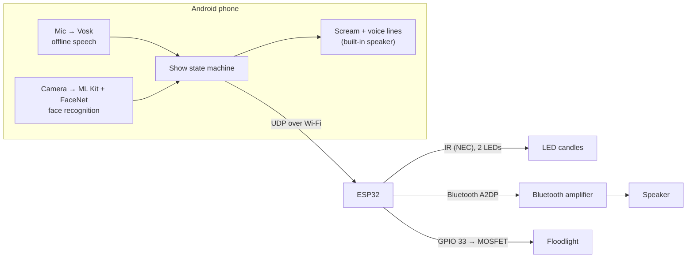

# Bloody Mary

[](https://github.com/ryosep2/bloody-mary/actions/workflows/build.yml)
[](LICENSE)


An interactive haunted-bathroom scare based on the Bloody Mary legend. A hidden
Android phone listens for a guest saying **"bloody mary"**. Each time it hears
the phrase, it tells an ESP32 to escalate the scene: the candles die, something
tries to break in, and then the mirror lights up with a scream.

## How it works

| Moment | What happens |
|--------|--------------|
| Guest walks in     | The phone's camera recognizes them and Mary greets them by name in a creepy ElevenLabs voice ("Sarah... I've been waiting for you"). Unknown faces get a nameless greeting |
| 1st "bloody mary"            | The flickering LED candles go out (IR remote code, sent 3× to reach every candle) |
| 2nd "bloody mary"  | Someone tries the door knob, knocks softly, then pounds on the door (Bluetooth audio on a stereo speaker) |
| 3rd "bloody mary"  | A floodlight lights up a mask behind a shadow box, the phone screams, then Mary says something horrible to the guest by name |

After 1 minute without a new "bloody mary", whether mid-show or after the
scream, everything resets by itself for the next guest: candles back on, light
off. The app also has a **Reset** button.



**Highlights**
- Fully offline speech recognition ([Vosk](https://alphacephei.com/vosk/)),
  limited to the phrase itself to cut down false triggers
- The ESP32 streams WAV audio from its own flash straight to a Bluetooth
  amplifier, so no extra audio hardware is needed
- Two IR LEDs driven by the same hardware PWM channel, each covering half of the candles
- Low-latency triggers: one UDP packet per effect, with the scream preloaded
- On-device face recognition (ML Kit + FaceNet). Photos and face data never leave the phone
- Personalized voice lines generated once with [ElevenLabs](https://elevenlabs.io)
  and cached, so they play instantly and offline during the show
- Every effect can be tested without the phone, over serial or `curl`

## Hardware

| Part | Notes |
|------|-------|
| ESP32 DevKit V1 (DOIT) | Any classic ESP32 works. Bluetooth audio needs Classic BT, so no S2/S3/C3 |
| 2× IR LED (940 nm) + resistors | One per half of the candle array. A transistor driver gives better range |
| Remote-controlled LED candles | NEC protocol. Other protocols work after capturing their codes |
| Bluetooth amplifier + passive speaker | Built with a Facmogu F900S (BT 5.0, 12 V) |
| 5 V USB spotlight | Must turn on when powered, with no button press |
| Logic-level N-MOSFET (AO3400, IRLZ44N) + 10 kΩ resistor | Or a 3.3 V-triggered relay module |
| Android phone | Built with a Galaxy S22, Android 10+ |

### Wiring

| Function    | ESP32 pin | Connection |
|-------------|-----------|------------|
| IR LED 1    | GPIO 27   | Anode, through the resistor or driver |
| IR LED 2    | GPIO 25   | Same, carries an identical signal to GPIO 27 |
| Floodlight  | GPIO 33   | MOSFET gate, with 10 kΩ gate → GND. The MOSFET switches the spotlight's USB ground |

## Getting started

### 1. Firmware (ESP32)

You need [PlatformIO](https://platformio.org/), either the VS Code extension or
the CLI. The libraries ([IRremote](https://github.com/Arduino-IRremote/Arduino-IRremote)
and [ESP32-A2DP](https://github.com/pschatzmann/ESP32-A2DP)) install
automatically.

```sh
cp include/secrets.example.h include/secrets.h   # add your 2.4 GHz Wi-Fi name and password
```

Set your serial port in [platformio.ini](platformio.ini). `project_linux` uses
`/dev/ttyUSB0` and `project_windows` uses `COM3`; `esp32doit-devkit-v1`
auto-detects.

### 2. Break-in audio

The ESP32 plays `data/breakin.wav` from flash. This needs to be a 16-bit PCM
WAV, mono or stereo, at 22050 or 44100 Hz. There's about 1.9 MB of room, which
holds roughly 43 s at 22 kHz mono. To shrink a 44.1 kHz stereo file:

```sh
python3 tools/convert_audio.py my-door-sounds.wav data/breakin.wav
```

Audio files aren't included in this repo; use your own or freely licensed ones
(e.g. from [Freesound](https://freesound.org) or [Pixabay](https://pixabay.com/sound-effects/)).

### 3. Flash and pair

```sh
pio run -e project_linux -t uploadfs   # audio
pio run -e project_linux -t upload     # firmware
pio device monitor -e project_linux    # 115200 baud
```

Put the amplifier in Bluetooth mode. The log lists every speaker the ESP32
finds, then connects:

```
[amp] /breakin.wav: 1 ch, 22050 Hz, 15.5 s
[amp] found "F900S" (rssi -48) <- connecting
[amp] connected
[web] connected, IP 192.168.1.50
```

If your amplifier has a different name, set `AMP_BT_NAME` in
[src/main.cpp](src/main.cpp). Give the ESP32 a DHCP reservation in your router
so its IP address stays the same.

### 4. Android app

1. Download [vosk-model-small-en-us-0.15](https://alphacephei.com/vosk/models)
   and unzip its contents (`am/`, `conf/`, `graph/`, `ivector/`) into
   `android/app/src/main/assets/model-en-us/`.
2. Download the face model
   [facenet_512.tflite](https://github.com/shubham0204/FaceRecognition_With_FaceNet_Android/raw/master/app/src/main/assets/facenet_512.tflite)
   (Apache-2.0) into `android/app/src/main/assets/`.
3. Add the scream as `android/app/src/main/assets/scream.mp3` (or `.wav`).
4. Open the `android/` folder in Android Studio. Connect the phone with USB
   debugging on, and press **Run**.
5. Allow microphone and camera access. Enter the ESP32's address
   (`bloodymary.local` usually works, otherwise use its IP). The status line
   should read `amp connected`.

### 5. Guests and voice

1. **Voice:** in **Settings**, enter your ElevenLabs API key and a voice ID
   (pick a scary voice in the ElevenLabs Voice Library and copy its ID). The
   model defaults to `eleven_v4`. The key is stored only on the phone.
2. **Guests**, either way, or both:
   - **Import photos:** put photos in a folder on the phone, named after each
     guest (`Sarah.jpg`, `Sarah_2.jpg`, `Mary_Jane.png`), and pick that folder.
     Several photos per person improve recognition.
   - **Add guest:** type a name, have them look at the camera, press Capture.
3. Each guest's greeting and finale lines are generated right away and saved.
   This needs internet then, but not during the show. Only the line's text,
   including the guest's name, is sent to ElevenLabs; photos and face data stay
   on the phone. **Guests → Generate
   voices** fills in anything missing, and lines already generated aren't paid
   for again.

Edit the lines in `VoiceLines` ([VoiceBank.kt](android/app/src/main/java/com/bloodymary/app/VoiceBank.kt)).
Changed lines are regenerated automatically. Until a line is generated, the
phone's own voice says it, pitched down.

**Camera placement:** the phone has to see guests' faces with some light on
them. Candlelight alone is often too dark for recognition, so a dim light on
the face helps. Set front or back camera in **Settings**. The screen shows who
it sees and the match score; names are used above 0.5 (`MATCH_THRESHOLD` in
`GuestStore.kt`).

The show resets itself after 1 minute idle. **Reset** does it by hand, and
**Next stage** fires the next effect for rehearsals. The screen shows what the
recognizer is hearing, which helps when tuning.

## Testing without the phone

**Serial monitor keys**

| Key | Action |
|-----|--------|
| `0` / `1` | Candles off / on (3× burst) |
| `a` | Play break-in audio |
| `l` | Toggle floodlight |
| `x` | Reset |

**HTTP API.** The app uses `/status` and `/reset`. The others are for testing.
Each returns the status as JSON.

| Endpoint | Action |
|----------|--------|
| `GET /candles/off` | IR candle-off burst |
| `GET /audio/play` | Start the break-in audio |
| `GET /light/on` | Floodlight on |
| `GET /reset` | Light off, audio off, candles on |
| `GET /status` | `{"ip":"…","amp_connected":true,"playing":false,"light":false}` |

```sh
curl http://192.168.1.50/candles/off
```

**UDP triggers.** The app sends show triggers as a single UDP packet
`"<id> <command>"` to port 4210, using the commands `candles_off`,
`audio_play`, `light_on` and `reset`. While Bluetooth is on, the ESP32's Wi-Fi
only wakes about every 100 ms, so one packet is much faster than an HTTP
request's several round trips. Each packet is sent 3 times, and the ESP32 runs
it once.

```sh
echo "1 candles_off" | nc -u -w1 192.168.1.50 4210
```

**Using a different remote:** capture its codes with an IR receiver and the
IRremote `ReceiveDump` example, then update the codes in
[src/candles.cpp](src/candles.cpp).

## Project structure

```
├── src/                 ESP32 firmware
│   ├── main.cpp         Pins, floodlight, serial commands
│   ├── candles.cpp      IR candle codes, bursts, mirrored second LED
│   ├── amp_audio.cpp    WAV parsing and Bluetooth A2DP streaming
│   └── web.cpp          Wi-Fi, mDNS, UDP triggers and HTTP endpoints
├── include/             Headers and secrets.example.h
├── data/                Audio flashed to LittleFS (not committed)
├── tools/               Audio conversion script
├── android/             Android app (Kotlin)
│   └── app/src/main/java/com/bloodymary/app/
│       ├── MainActivity.kt     Operator screen
│       ├── PhraseListener.kt   Vosk phrase detection (strict "bloody mary")
│       ├── FaceWatcher.kt      Camera analysis and live enrollment
│       ├── FaceRecognizer.kt   ML Kit face detection + FaceNet embeddings
│       ├── GuestStore.kt       Known guests and face matching
│       ├── VoiceBank.kt        ElevenLabs voice lines, cache and playback
│       ├── ShowController.kt   Three-stage show, idle auto-reset, preloaded scream
│       └── Esp32Client.kt      UDP triggers + HTTP status/reset
└── platformio.ini       Board, libraries, partitions, ports
```

## Troubleshooting

| Problem | Fix |
|---------|-----|
| Upload fails with permission denied on `/dev/ttyUSB0` | Add your user to `dialout` (Debian/Ubuntu) or `uucp` (Arch), then log in again. Close the serial monitor before uploading |
| `[amp] /breakin.wav missing` | Run the `uploadfs` step |
| Amplifier never connects | Check the `[amp] found …` lines and set `AMP_BT_NAME` to match |
| App says "ESP32: not reachable" | Use the IP from the serial log instead of `bloodymary.local`. The phone and ESP32 must be on the same network |
| Some candles stay lit | Aim the IR LED better, add a transistor driver, or raise `BURST_COUNT` in `src/candles.cpp` |
| Triggers before "mary" is said | Set `CONFIRM_PARTIALS = 2` in `PhraseListener.kt` (adds about 0.2 s) |
| Phrase not picked up | Speak clearly toward the phone. The "Heard" line shows what it recognized |
| Guests greeted as unknown | Add more light on faces, import more photos per guest, or lower `MATCH_THRESHOLD` |
| Wrong name used | Raise `MATCH_THRESHOLD` in `GuestStore.kt` |
| Voice sounds robotic | ElevenLabs lines aren't generated yet. Check Settings, then **Guests → Generate voices** |

## License

[MIT](LICENSE)
