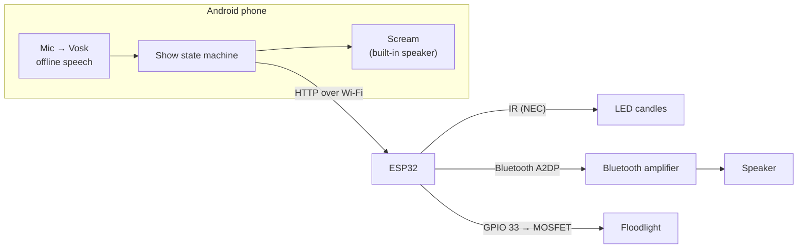

# Bloody Mary

[](https://github.com/ryosep2/bloody-mary/actions/workflows/build.yml)
[](LICENSE)


An interactive haunted-bathroom scare based on the Bloody Mary legend. A hidden
Android phone listens for a guest saying **"bloody mary"**. Each time it hears
the phrase, it tells an ESP32 to escalate the scene: the candles die, something
tries to break in, and then the mirror lights up with a scream.

## How it works

| Says "bloody mary" | What happens                                                                 |
|--------------------|------------------------------------------------------------------------------|
| 1st time           | The flickering LED candles go out (IR remote code, sent 3× to reach every candle) |
| 2nd time           | Someone tries the door knob, knocks softly, then pounds on the door (Bluetooth audio on a stereo speaker) |
| 3rd time           | A floodlight lights up a mask behind a shadow box, and the phone screams      |

A **Reset** button in the app relights the candles and turns everything off for
the next guest.



**Highlights**
- Fully offline speech recognition ([Vosk](https://alphacephei.com/vosk/)),
  limited to the phrase itself to cut down false triggers
- The ESP32 streams WAV audio from its own flash straight to a Bluetooth
  amplifier, so no extra audio hardware is needed
- Built-in IR sniffer to capture and replay codes from any remote
- Every effect can be tested without the phone, over serial or `curl`

## Hardware

| Part | Notes |
|------|-------|
| ESP32 DevKit V1 (DOIT) | Any classic ESP32 works. Bluetooth audio needs Classic BT, so no S2/S3/C3 |
| IR LED (940 nm) + resistor | A transistor driver gives better range |
| 38 kHz IR receiver (VS1838B / TSOP38238) | Only needed to capture codes from a new remote |
| Remote-controlled LED candles | NEC protocol. Other protocols work after capturing their codes |
| Bluetooth amplifier + passive speaker | Built with a Facmogu F900S (BT 5.0, 12 V) |
| 5 V USB spotlight | Must turn on when powered, with no button press |
| Logic-level N-MOSFET (AO3400, IRLZ44N) + 10 kΩ resistor | Or a 3.3 V-triggered relay module |
| Android phone | Built with a Galaxy S22, Android 10+ |

### Wiring

| Function    | ESP32 pin | Connection |
|-------------|-----------|------------|
| IR receiver | GPIO 25   | Receiver OUT pin |
| IR LED      | GPIO 27   | Anode, through the resistor or driver |
| Floodlight  | GPIO 33   | MOSFET gate, with 10 kΩ gate → GND. The MOSFET switches the spotlight's USB ground |

## Getting started

### 1. Firmware (ESP32)

You need [PlatformIO](https://platformio.org/), either the VS Code extension or
the CLI. The libraries ([IRremote](https://github.com/Arduino-IRremote/Arduino-IRremote)
and [ESP32-A2DP](https://github.com/pschatzmann/ESP32-A2DP)) install
automatically.

```sh
cp include/secrets.example.h include/secrets.h   # add your 2.4 GHz Wi-Fi name and password
```

Set your serial port in [platformio.ini](platformio.ini). `project_linux` uses
`/dev/ttyUSB0` and `project_windows` uses `COM3`; `esp32doit-devkit-v1`
auto-detects.

### 2. Break-in audio

The ESP32 plays `data/breakin.wav` from flash. This needs to be a 16-bit PCM
WAV, mono or stereo, at 22050 or 44100 Hz. There's about 1.9 MB of room, which
holds roughly 43 s at 22 kHz mono. To shrink a 44.1 kHz stereo file:

```sh
python3 tools/convert_audio.py my-door-sounds.wav data/breakin.wav
```

Audio files aren't included in this repo; use your own or freely licensed ones
(e.g. from [Freesound](https://freesound.org) or [Pixabay](https://pixabay.com/sound-effects/)).

### 3. Flash and pair

```sh
pio run -e project_linux -t uploadfs   # audio
pio run -e project_linux -t upload     # firmware
pio device monitor -e project_linux    # 115200 baud
```

Put the amplifier in Bluetooth mode. The log lists every speaker the ESP32
finds, then connects:

```
[amp] /breakin.wav: 1 ch, 22050 Hz, 15.5 s
[amp] found "F900S" (rssi -48) <- connecting
[amp] connected
[web] connected, IP 192.168.1.50
```

If your amplifier has a different name, set `AMP_BT_NAME` in
[src/main.cpp](src/main.cpp). Give the ESP32 a DHCP reservation in your router
so its IP address stays the same.

### 4. Android app

1. Download [vosk-model-small-en-us-0.15](https://alphacephei.com/vosk/models)
   and unzip its contents (`am/`, `conf/`, `graph/`, `ivector/`) into
   `android/app/src/main/assets/model-en-us/`.
2. Add the scream as `android/app/src/main/assets/scream.mp3` (or `.wav`).
3. Open the `android/` folder in Android Studio. Connect the phone with USB
   debugging on, and press **Run**.
4. Allow microphone access and enter the ESP32's IP address. The status line
   should read `amp connected`.

Press **Reset** before each guest. **Next stage** fires the next effect by hand,
for rehearsals.

## Testing without the phone

**Serial monitor keys**

| Key | Action |
|-----|--------|
| `0` / `1` | Candles off / on (3× burst) |
| `a` | Play break-in audio |
| `l` | Toggle floodlight |
| `x` | Reset |
| `r` | Replay the last captured IR code |

**HTTP API.** These are the endpoints the app uses. Each returns the status as JSON.

| Endpoint | Action |
|----------|--------|
| `GET /candles/off` | IR candle-off burst |
| `GET /audio/play` | Start the break-in audio |
| `GET /light/on` | Floodlight on |
| `GET /reset` | Light off, audio off, candles on |
| `GET /status` | `{"ip":"…","amp_connected":true,"playing":false,"light":false}` |

```sh
curl http://192.168.1.50/candles/off
```

**Capturing another remote:** point it at the IR receiver and press a button.
The log prints the protocol, address and command, plus a ready-to-paste
`IrSender.send…` line. The candle codes live in [src/candles.cpp](src/candles.cpp).

## Project structure

```
├── src/                 ESP32 firmware
│   ├── main.cpp         Pins, floodlight, serial commands, IR sniffer
│   ├── candles.cpp      IR candle codes and bursts
│   ├── amp_audio.cpp    WAV parsing and Bluetooth A2DP streaming
│   └── web.cpp          Wi-Fi, mDNS and HTTP endpoints
├── include/             Headers and secrets.example.h
├── data/                Audio flashed to LittleFS (not committed)
├── tools/               Audio conversion script
├── android/             Android app (Kotlin)
│   └── app/src/main/java/com/bloodymary/app/
│       ├── MainActivity.kt     Operator screen
│       ├── PhraseListener.kt   Vosk phrase detection with cooldown
│       ├── ShowController.kt   Three-stage show logic and scream playback
│       └── Esp32Client.kt      HTTP client with retries
└── platformio.ini       Board, libraries, partitions, ports
```

## Troubleshooting

| Problem | Fix |
|---------|-----|
| Upload fails with permission denied on `/dev/ttyUSB0` | Add your user to `dialout` (Debian/Ubuntu) or `uucp` (Arch), then log in again. Close the serial monitor before uploading |
| `[amp] /breakin.wav missing` | Run the `uploadfs` step |
| Amplifier never connects | Check the `[amp] found …` lines and set `AMP_BT_NAME` to match |
| App says "ESP32: not reachable" | Use the IP from the serial log instead of `bloodymary.local`. The phone and ESP32 must be on the same network |
| Some candles stay lit | Aim the IR LED better, add a transistor driver, or raise `BURST_COUNT` in `src/candles.cpp` |
| Triggers fire twice | Raise `COOLDOWN_MS` in `PhraseListener.kt` |

## License

[MIT](LICENSE)
